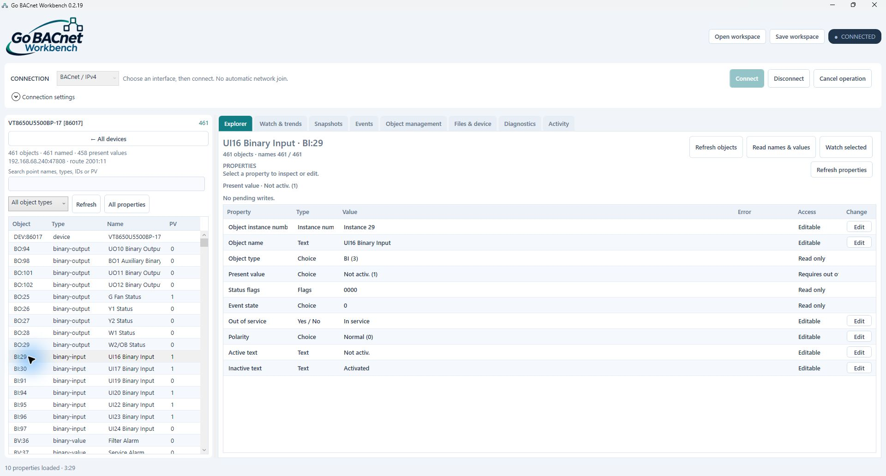

# Go BACnet Workbench

A Windows desktop application for discovering BACnet devices, inspecting objects,
editing properties, and troubleshooting building automation networks.

**[Download the Windows installer](https://github.com/cplymill/go-bacnet-workbench/releases/download/v0.2.21/GoBACnetWorkbench-0.2.21-x64.msi)**

Windows is the primary supported application. The installer includes the runtime
and compiled BACnet engine; Go and .NET are not required to use it.

Read the **[full product specification](docs/SPECIFICATION.md)** for all implemented
workflows, transport settings, limits, exports and Windows/Mac differences.



Actual Windows 0.2.19 application connected to a device. Version 0.2.21 retains this
Windows interface and adds priority-array and relinquish-default snapshot comparison.

## Working with devices

- Discover devices and routers, browse objects, and search arriving object names.
- Inspect properties, edit supported values, and read changes back from the device.
- Work with command priorities, schedules, calendars, watches, trends and exports.
- Cancel a search, select a different target, disconnect, or close during discovery.
- Save workspaces and compare device snapshots, including individual priority
  slots and relinquish defaults. See the [priority baseline guide](docs/PRIORITY_BASELINES.md).

Choose the correct network interface, connect, and discover. For directed IPv4
discovery, enter an address such as `192.168.47.10` (default port 47808) or
`192.168.47.10:47808`. Use Cancel operation to retain discoveries while stopping
the scan. Discover devices replaces an active search. Use the application only on
networks and equipment you are authorized to access; confirm the target before writes.

## macOS: untested desktop preview

Full desktop application bundles are available for
[Apple Silicon](https://github.com/cplymill/go-bacnet-workbench/releases/download/v0.2.21/GoBACnetWorkbench-0.2.21-osx-arm64-UNTESTED.zip)
and [Intel](https://github.com/cplymill/go-bacnet-workbench/releases/download/v0.2.21/GoBACnetWorkbench-0.2.21-osx-x64-UNTESTED.zip).
They include the runtime and compiled engine. Extract the archive and copy the
application to Applications; see the included preview instructions.

These builds have **not been run on a Mac**. They are unsigned and not notarized,
and macOS may block opening them. The interface has automated headless checks on
Windows; that does not establish macOS runtime, hardware or network compatibility.
The Mac interface differs from the Windows WPF application.

## Source and licensing

The application source, including its stdio adapter, is available under
[Apache License 2.0](LICENSE.txt). Apache permits commercial use and provides the
application without warranty, subject to applicable law.

The **Go BACnet Stack implementation is proprietary and is not included in this
repository or its Git history**. Official downloads contain its compiled engine
under the separate [engine binary license](ENGINE-LICENSE.txt). That license
permits use with Workbench and redistribution of the unmodified engine with
Workbench, including modified Workbench applications; it does not grant a general
SDK or integration license. Third-party components retain their own licenses.
See [NOTICE](NOTICE).

Compiling source into a binary does not make reverse engineering impossible.
The source separation and binary license protect the stack's distribution rights.

## Building the application interface

Install the .NET 10 SDK. Obtain the compiled engine from the official release or
your installed Windows application. Keep its license and third-party notices with
redistributed builds. On Windows:

```powershell
./desktop/build-public.ps1 -EngineDirectory "$env:LOCALAPPDATA/Programs/Go BACnet Workbench"
./bin/public-win-x64/GoBACnetWorkbench.exe
```

The public build compiles the interface and copies the supplied engine and notices.
It does not need or download proprietary stack source. You can also build the Mac
interface with `dotnet publish desktop/CrossPlatform/Workbench.CrossPlatform.csproj
-c Release -r osx-arm64 --self-contained true`; assembling an application bundle
requires the matching Mac engine and its release resources.

The Go adapter source imports the proprietary stack's public Go API. Rebuilding
that adapter requires a separately licensed stack development checkout; the
relative replacement in `go.mod` documents the maintainer's dependency, not an
included SDK. Ordinary application contributors can modify the C# interface and
use the official compiled engine.

## Validation

Contributors and coding agents must follow the
[contribution and Git workflow](CONTRIBUTING.md). It covers branches, reviewed PRs,
local hooks, CI, release tags, signing and the private-engine boundary.

```powershell
dotnet run --project desktop/checks/DesktopChecks.csproj -c Release
dotnet run --project desktop/CrossPlatform.Checks/Workbench.CrossPlatform.Checks.csproj -c Release
```

Windows UI checks use bounded pipe fixtures by default. The cross-platform checks
render the production window headlessly and exercise discovery, editing, watches,
schedule/calendar models and shutdown without contacting devices.
See [release evidence](docs/releases/0.2.21.json) for the tested release boundary.
