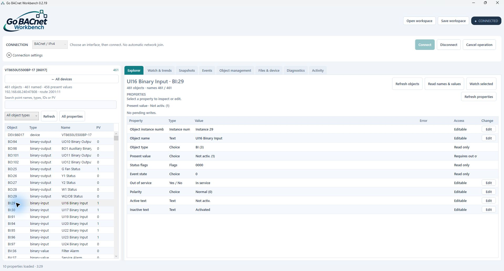

# Go BACnet Workbench — product specification

**Version covered:** 0.2.20  
**Reviewed:** November 23, 2026  
**Primary application:** Windows x64 desktop  
**Additional distribution:** untested macOS desktop preview, Apple Silicon and Intel

This specification describes implemented application behavior in the published
0.2.20 source and release packages. It separates available controls from tested
platform behavior. A remote device must support and authorize a requested service
for that operation to succeed. This document is not a BTL certification, PICS,
claim of universal device compatibility, or specification of every capability in
the separately licensed Go BACnet Stack.

## Contents

1. [Product and architecture](#1-product-and-architecture)
2. [Platforms and installation](#2-platforms-and-installation)
3. [Connections and transports](#3-connections-and-transports)
4. [Discovery and navigation](#4-discovery-and-navigation)
5. [Object and property inspection](#5-object-and-property-inspection)
6. [Editing and command priorities](#6-editing-and-command-priorities)
7. [Schedules and calendars](#7-schedules-and-calendars)
8. [Watches, COV and trends](#8-watches-cov-and-trends)
9. [Snapshots, workspaces and exports](#9-snapshots-workspaces-and-exports)
10. [Events and log reads](#10-events-and-log-reads)
11. [Files and device management](#11-files-and-device-management)
12. [Diagnostics and operation reporting](#12-diagnostics-and-operation-reporting)
13. [Cancellation, recovery and data handling](#13-cancellation-recovery-and-data-handling)
14. [Resource limits](#14-resource-limits)
15. [Platform feature matrix](#15-platform-feature-matrix)
16. [Engine operation inventory](#16-engine-operation-inventory)
17. [Validation and boundaries](#17-validation-and-boundaries)
18. [Licensing and source availability](#18-licensing-and-source-availability)

## 1. Product and architecture

Go BACnet Workbench is an interactive desktop client for BACnet discovery,
inspection, troubleshooting and commissioning. Its Windows interface is C#/.NET
WPF. Its Mac preview uses C#/.NET and Avalonia. Both launch a separate local Go
engine and exchange request/response JSON and progress updates over inherited
standard-input/output pipes.

The engine uses the existing Go BACnet Stack for protocol behavior. Workbench
does not implement a second protocol stack, and its desktop control channel does
not expose an HTTP server. BACnet connections still open the network or serial
resources selected by the operator. One active link is owned by a connected
Workbench session; changing transports requires disconnecting first.

The application can discover, read and issue supported writes to remote devices.
It is not a replacement controller runtime, automation scheduler, always-running
historian, general BACnet server, router or BBMD administration product. Reading
router and BBMD information does not turn the application into those devices.

## 2. Platforms and installation

| Distribution | Package | Status |
| --- | --- | --- |
| Windows x64 | `GoBACnetWorkbench-0.2.20-x64.msi` | Primary release; automated desktop/engine checks and installer payload verification passed |
| macOS Apple Silicon | `GoBACnetWorkbench-0.2.20-osx-arm64-UNTESTED.zip` | Complete desktop app bundle; not run on Mac hardware |
| macOS Intel | `GoBACnetWorkbench-0.2.20-osx-x64-UNTESTED.zip` | Complete desktop app bundle; not run on Mac hardware |

The Windows installer includes the .NET runtime and compiled engine, installs
per user under the user's local Programs directory, adds a Start Menu shortcut,
supports upgrades through the retained product upgrade identity, and supports
uninstall through Windows Apps. Installing Go or .NET separately is unnecessary
for the official standalone package. Serial adapter drivers and permission to
open the selected network/serial resources remain environment requirements.

Mac archives include the self-contained interface, native libraries, engine,
license notices and preview instructions in an `.app` distribution. The bundle
declares macOS 14 as its minimum version; this is a packaging target, not a tested
compatibility result. The Mac packages are unsigned and not notarized. macOS may
block opening them. No Windows ARM, Linux package, Mac installer, automatic
updater or Mac hardware qualification is claimed for 0.2.20.

The published [release](https://github.com/cplymill/go-bacnet-workbench/releases/tag/v0.2.20)
includes SHA-256 checksums for the three application downloads.

## 3. Connections and transports

The connection settings show fields for the selected transport. General controls
include local network number, request timeout and retry count. The engine
accepts a timeout of 100–30,000 milliseconds and 0–5 retries.

| Transport | Implemented connection settings and behavior |
| --- | --- |
| BACnet/IPv4 | Select a detected local IPv4 interface/address and UDP port, or enter a bind address; directed broadcast address; subnet broadcast derived from detected interfaces |
| IPv4 foreign device | Optional BBMD endpoint and registration lifetime; UI lifetime 30–3,600 seconds |
| BACnet MS/TP | Serial port, baud rate, unused manager MAC, Max_Master and link network; confirmation of unused MAC and exclusive serial ownership before opening |
| BACnet/IPv6 | Explicit IPv6 bind address, multicast interface index and three-octet VMAC |
| BACnet Secure Connect | Primary hub URI, optional failover hub URI, six-octet VMAC, retained UUID, client certificate, private key and site CA files; hub name verification option |

MS/TP validates MAC 0–127, Max_Master at least the local MAC and at most 127,
and a nonzero link network. Windows offers 9,600, 19,200, 38,400, 57,600, 76,800
and 115,200 baud selections; actual acceptance depends on engine and adapter
support. The connection waits for token-ring participation or sole-manager
formation before discovery. Startup allows up to 60 seconds for MS/TP and up to
20 seconds for other links, subject to cancellation.

Secure Connect loads the selected credential pair and issuer store through the
shared stack APIs. Workbench does not issue certificates or provide a hub
management interface. The exposed IPv6 and SC connection paths do not establish
that those transports passed the stack's separate release-promotion gates or
that they work with every field installation. Mac serial, IPv6, SC and network
behavior remain untested on Mac hardware.

## 4. Discovery and navigation

- Broadcast discovery and directed discovery use Who-Is/I-Am through the selected
  link. An optional device-instance low/high range narrows the request; both
  bounds are required together.
- IPv4 directed targets accept `address:port`; a bare IPv4 address defaults to
  UDP port 47808. Directed MS/TP targets use hexadecimal MAC text.
- Remote-network selection supports local discovery, a selected remote network,
  or the global network setting. Directed-target and remote-broadcast modes are
  mutually exclusive.
- General discovery queries routers and collects reachable network information.
  Local Who-Is requests repeat during the scan. Names and discoveries arrive
  progressively rather than waiting for the entire scan to finish.
- Device records include device identifier/instance, name, address, route,
  vendor, maximum APDU, segmentation information and last-seen time. Router
  records include learned network numbers.
- Duplicate device instances retain separate address-qualified bindings rather
  than being merged into one target.
- Windows groups discovered routed devices under routers. Selecting a device
  focuses the left pane on its objects; All devices returns to the discovery
  list. The Mac preview uses a device list with address/route details.
- Object inventory arrives in pages, then names, present values and units are
  enriched. Search updates as names and values arrive. Windows additionally
  provides type-group filters, including analog, binary, schedules, calendars,
  files and logs.

The default discovery window is 30 seconds. Windows accepts 5–120 seconds;
the Mac preview and engine accept 1–120 seconds. Discover devices can replace an
active discovery. Cancel retains discoveries already received. Disconnect or
closing also interrupts active discovery. Selecting an object can interrupt
background inventory enrichment to load that object's properties.

## 5. Object and property inspection

The explorer presents object identity, type, name and available present value.
It understands abbreviated labels such as `AI:1`, `BI:6`, `AV:1`, `SCH:1` when
recognized by the label map, and numeric `type:instance` identities. Persisted
identities remain numeric. Unknown/proprietary numeric object types can be
addressed without pretending that they have a dedicated visual editor.

For a selected object, the inspector displays property identifier/name, reported
datatype, formatted value, errors and available editing guidance. The Windows
inspector also provides explicit access explanations and an expandable encoded
hex view. Property errors remain individual observations; an oversized property
does not need to hide every other property.

Property enumeration first attempts ReadPropertyMultiple with ALL. It can fall
back to Property_List and individual reads; older peers without Property_List
use a bounded common-property fallback. Object_List uses indexed/paged reads
instead of assuming that the complete list fits a single response. Selective
reads use bounded batches through the existing stack's remote-read owner.

Windows advanced property controls accept standard names or proprietary numeric
property IDs and an optional array index. Read present value explicitly targets
the selected object's present-value property. The Mac preview exposes additional
selectors through Advanced typed operation. Displaying an object type or
property does not guarantee that the remote peer implements it.

## 6. Editing and command priorities

### Property values

The application uses observed datatypes and shared edit policy to preflight a
write. Supported primitive values include text, boolean, signed/unsigned integer,
real/double, enumerated value, bit string, date, time, octet string, object
identifier and NULL where appropriate. Context supplies friendly choices for
supported properties such as boolean states, units and enumerations.

Windows provides dedicated controls for flags, dates/times, object references,
device/object instance numbers, recognized IPv4 address properties and supported
primitive lists. List editing preserves the existing element types and count.
Names can be entered as plain text. An instance-number edit preserves object
type. Device identifier changes update the application's bound identity from the
result. The Mac preview uses a selected-property value field and contextual
choices rather than reproducing every WPF editor control.

Known read-only properties are protected. Conditional input overrides require
appropriate Out_Of_Service state. A successful read is not treated as permission
to write. Unsupported constructed values may be inspected or addressed through
available advanced controls, but are not represented as having a universal
point-and-click editor. The device remains the final authority on its writes.

Single-property Save preflights the target, datatype and relevant observed state,
sends one write, and reads the affected property back. Ordinary Save does not add
a second bulk-style confirmation. Refresh preserves an unsent selected-property
draft; navigation asks before discarding affected local editor changes.

### Commandable properties

Windows displays the sixteen priority slots, relinquish default and effective
present value when available. Operators can stage slot values, preview a set of
changes, write selected changes, relinquish a selected priority or relinquish all
fifteen operator priorities. The application uses the reported present-value
type. **Priority 6 is visible for diagnosis but reserved against operator writes
and relinquishment.** Relinquish sends NULL at an explicit priority.

Mac provides priority-array inspection and an explicit priority for selected
property writes/relinquishment. It does not provide the WPF multi-cell priority
staging table or its relinquish-all operator-priorities control.

Windows also supports selected-object bulk writes with exact targets and
priorities previewed before sending. Writes are independent, stop at the first
failure, and do not roll back earlier acknowledgments. Acknowledgment does not
prove that a commanded value becomes the effective present value: another
priority or device logic can prevail. After cancellation or timeout following
transmission, read back before deciding whether to retry.

## 7. Schedules and calendars

### Schedule objects

Workbench edits existing remote Schedule objects; it does not execute those
schedules itself. The structured Schedule editor handles:

- Seven daily schedules with typed time/value transitions.
- Timed blocks and copying a selected day to weekdays.
- Schedule_Default using the schedule's datatype context.
- Effective_Period start/end dates, including open bounds.
- Exception_Schedule entries with date patterns, date ranges, week/day recurrence
  or Calendar references, event priorities and time/value transitions.

Windows includes a seven-day visual block view with drag, move and resize,
exact transition editing, visual exception controls and date controls. Mac uses
daily transition tables, exact time fields and a Set time block action; its
exception schedule is edited as typed JSON, not the Windows visual exception UI.

### Calendar objects

Calendar editing supports date patterns, inclusive date ranges and recurring
month/week/weekday rules. Windows provides a month/rule editor. Mac provides an
editable rule-list workflow with add, update and remove actions.

### Saving structured values

Edits remain local until the operator requests a save and confirms its target
and content. The loaded device/object identity is retained. Before transmission,
the engine compares freshly read property bytes with the loaded baseline to
reject stale edits. It writes changed properties independently and reads back
acknowledged values. Partial-write failures report progress; there is no atomic
multi-property transaction or automatic rollback. Read errors on individual
schedule properties do not confer permission to replace unread values.

The adapter bounds each daily schedule and each exception's time/value list to
256 entries, an exception schedule to 256 entries and a Calendar date list to
1,024 entries.

## 8. Watches, COV and trends

Add an object present value or selected property/array element to a watch.
Windows can add selected objects; Mac adds the selected property. Watch identity
includes the device binding, object, property and optional array index.

- Read watches on demand or poll at a 1–3,600 second interval.
- Poll cycles do not overlap; the next interval begins after a completed cycle.
- Subscribe to object-level COV and cancel the subscription. The UI requests
  unconfirmed notifications with a finite 120-second lifetime and renews while
  connected. Property coverage depends on what the device sends for that object;
  this is not a separate SubscribeCOVProperty interface.
- Watch state shows the most recent observation, update time and quality/error
  context. Samples record source and time.
- Numeric samples can be charted. Missing/non-numeric/error observations create
  gaps instead of an invented numeric value. The Mac chart renders the latest
  120 of the retained samples.
- Export watch history to CSV. Remove watches and cancel their subscriptions.

Polling and received COV updates preserve property editor selection and drafts.
Foreground actions can cancel and drain a read-only poll. Subscription renewal
is coordinated separately. History is a bounded in-memory record, not a durable
database or background recording service after the application exits.

## 9. Snapshots, workspaces and exports

A baseline captures inventory enrichment observations: object names, present
values and units. Comparison reads a fresh inventory and classifies observations
as added, removed, changed or unchanged. This is an observation comparison, not
a complete controller backup or a restore operation.

Windows provides baseline load/save, a differences table and differences CSV
export. Mac retains the baseline in the workspace and presents comparison JSON
in Tools & diagnostics, where the result can be exported. It does not provide the
separate Windows baseline-file buttons or differences table.

Version 1 JSON workspaces store connection configuration, watch definitions and
the captured baseline. Loading requires an offline session and does not connect,
join an MS/TP ring or restart live subscriptions. Rediscovery refreshes live
bindings. Sample history is not a workspace historian. Duplicate watch/baseline
selectors, unsupported versions and oversized imports are rejected.

| Data | Windows export | Mac preview export |
| --- | --- | --- |
| Workspace | JSON | JSON |
| Standalone baseline | JSON | Baseline retained in workspace |
| Snapshot differences | CSV | Comparison result JSON |
| Selected object's properties | CSV | JSON |
| Watch sample history | CSV | CSV |
| Activity | CSV | JSON |
| Diagnostics/results | JSON | JSON |
| Device property database | JSON | JSON |
| File content | Binary stream or base64 record-array JSON | Binary stream or base64 record-array JSON |

Local saves use a temporary file followed by replacement. CSV exporters escape
formula-leading values. Workspaces and exports can contain network addresses,
device names and site observations; they are ordinary local files, not an
encrypted vault. Windows retains selected SC credential **paths** in its profile,
not key contents. Mac clears the private-key path on workspace save. Management
passwords are not part of the workspace format. Both clear the persisted MS/TP
join-confirmation grant.

## 10. Events and log reads

Active-event information is retrieved through paged GetEventInformation. Results
include object, state, notification type, acknowledged transitions, event
priorities and transition timestamps. The operator chooses the transition to
acknowledge and supplies an acknowledgment source. AcknowledgeAlarm uses that
returned transition timestamp and a target-specific confirmation. This is a
manual event read/acknowledgment workflow, not a general alarm-notification
receiver or automatic alarm acknowledgment system.

ReadRange reads bounded list/log data **by position**, with starting position at
least 1 and count 1–256. Returned information includes item count, flags, optional
first sequence number, formatted value and encoded data. Windows exposes object,
property and range controls. The Mac convenience action reads the selected
object's log-buffer; its label says starting sequence, but the engine request is
by position. Other selectors can use its advanced operation. Sequence-based and
time-based ReadRange selection are not exposed by this adapter.

Reading a Trend Log's remote buffer and plotting locally collected watch samples
are separate capabilities; neither promises complete historical recovery.

## 11. Files and device management

### BACnet File objects

Download or upload using stream or record access, a specified File object and an
explicit starting offset. Stream transfers use binary local files. Record files
use a JSON array of base64 record strings. Transfers use bounded blocks and check
that reads advance and returned offsets match the requested offsets.

Upload preflights the File object's observed Read_Only/access-method information
and requires target confirmation. An unknown access policy may still require
an explicit remote service attempt in the Windows workflow; Mac's convenience
upload requires a known matching observed method. Upload overwrites from its
starting position and **does not truncate trailing remote data**. It is not
atomic: acknowledged blocks remain written after interruption. Download and
compare to verify an upload's final content. Transferring a File object does not
constitute a device-independent firmware update or backup/restore facility.

### Object management

- Create an object with an exact identifier or request a device-assigned instance
  for a selected numeric object type.
- Supply up to 64 typed initial property values as JSON.
- Delete a selected object following target-specific confirmation.
- Export a device's object property database as JSON, reading objects in turn
  within an overall size limit and retaining property errors in results.

Object creation is a request to the remote peer. A numeric type selection does
not mean that the peer can create that type. There is no general object-copy or
database-import/restore workflow.

### Device services

- Send UTC time synchronization to the selected target. This unconfirmed BACnet
  service has no remote success acknowledgment; a successful send does not prove
  that the device clock changed.
- Request warm or cold ReinitializeDevice with an optional device password.
- Request DeviceCommunicationControl **Enable** or **Disable Initiation** with a
  selected duration and optional device password. Disable-all-communications is
  not offered by the adapter.

Changing actions present target-specific confirmation. Device implementation,
password policy and access controls determine whether a request succeeds.

## 12. Diagnostics and operation reporting

Diagnostics exposes application and network counters, plus transport-specific
counters where the engine supplies them. Other tools include router discovery,
read-only BBMD broadcast-distribution and foreign-device table inspection, and
received APDU metadata with observation/drop counts. BBMD inspection does not
write a BDT or configure another device's registrations. Received metadata is
not a promiscuous wire capture or a PCAP export facility.

An activity list records operation, target, time and result. Windows operation
alerts translate recognized errors, rejects, aborts and timeouts into readable
guidance while retaining technical reason/code/invoke-ID context. Unsupported
service guidance is provided for COV, event reads and ReadRange. Unknown errors
remain unknown rather than being assigned a guessed cause. An unsupported
service does not by itself force a disconnect or application-level retry.
Mac surfaces operation errors in its dialog/activity workflow, but does not
reproduce the Windows expandable operation-alert dialog.

## 13. Cancellation, recovery and data handling

The interface coordinates one foreground operation with monitoring work. The
engine admits one ordinary request at a time and handles cancellation control
separately. Search replacement, Cancel operation, Disconnect and close share the
owned engine lifecycle rather than leaving abandoned background searches.

The client bounds cancellation/control completion to approximately three
seconds. If its owned child stops responding or acknowledges cancellation
without settling the active operation, it closes that child and fails pending
calls. Reconnect can create a fresh engine. Observations and applicable local
drafts are retained for recovery. Shutdown also bounds unresponsive subscription
cleanup; any subscription not canceled remotely must expire by its finite
lifetime. No claim is made that stopping a local operation reverses a request
already accepted by a device.

The engine channel is local stdio, with bounded request/response sizes and strict
request decoding. Credentials selected for SC are read from local files; private
key contents are not embedded in workspace exports. Network access, encrypted
transport choice, local file permissions and authorization to control equipment
remain operator/environment responsibilities. The application does not add user
accounts, role management or an independent authorization server.

## 14. Resource limits

These are application guards, not guaranteed device capacity or performance.
Smaller peer/APDU/transport limits and errors can stop an operation earlier.

| Resource | Implemented bound |
| --- | --- |
| Connected links per session | 1 |
| Ordinary active engine requests | 1; cancellation is handled separately |
| Engine ordinary request context | 3 minutes; client wait guard 195 seconds |
| Cancellation/control wait | Approximately 3 seconds |
| IPC request / response | 1 MiB request; 32 MiB response |
| Discovered address-qualified bindings | 1,024 |
| Objects in an inventory | 10,000 |
| Selective read selectors / accumulated value data | 30,000 / 4 MiB |
| Watches / retained samples per watch | 64 / 1,000 |
| Poll interval | 1–3,600 seconds |
| UI COV subscription lifetime | 120 seconds, renewed while connected |
| Engine COV lifetime argument | 0–3,600 seconds; 0 cancels |
| Buffered COV notifications | 256; dropped/lost observations counted |
| Received APDU metadata rows | 1,000 |
| Activity rows | Windows 1,000; Mac preview 2,000 |
| Workspace/baseline input files | 16 MiB |
| Workspace baseline observations | 30,000 |
| File transfer data / device export data | 16 MiB application guard |
| File records per individual engine service call | At most 64; desktop loops normally use smaller requests |
| Active-event traversal | At most 64 advancing pages; per-page decoder bound 1,024 summaries |
| ReadRange items requested per call | 1–256, starting position at least 1 |
| Initial properties for CreateObject | 64 |
| Weekly transitions per day / exception time values | 256 / 256 |
| Schedule exceptions / Calendar entries | 256 / 1,024 |
| Offline selector normalization request | 64 selectors |
| Mac advanced JSON argument text | 512 KiB, also subject to IPC limits |

## 15. Platform feature matrix

“Implemented” below describes available source/control paths. Every Mac row
remains **untested on Mac hardware**. Windows and Mac do not have identical UI
or export formats.

| Capability | Windows WPF | Mac Avalonia preview |
| --- | --- | --- |
| IPv4, foreign device, MS/TP, IPv6 and SC configuration | Implemented | Implemented; hardware/network use untested |
| Discovery, cancellation, inventory enrichment and search | Implemented; router tree and type filters | Implemented; device list and text search |
| Property inspector and typed selected-property write | Implemented; dedicated controls | Implemented; value field/context choices |
| Arbitrary property/array selector | Advanced property controls | Advanced typed-operation JSON |
| Priority inspection and explicit-priority writes | Implemented | Implemented |
| Multi-cell priority staging and relinquish-all | Implemented | No equivalent dedicated control |
| Selected-object bulk write | Implemented with preview | No equivalent dedicated control |
| Weekly schedule and timed blocks | Visual seven-day drag/resize editor | Daily transition table and exact block fields |
| Schedule exceptions | Visual rule/transition editor | Typed JSON |
| Calendar | Month/rule editor | Rule list |
| Polling, object COV, watch samples and numeric trends | Implemented | Implemented |
| Workspace/baseline comparison | Dedicated Snapshots tab and file controls | Workspace baseline and comparison JSON |
| Active events, acknowledgment and range reads | Implemented | Implemented; log-buffer convenience action |
| File transfers and device/object management | Implemented | Implemented |
| Diagnostics and local activity | Implemented | Implemented |
| Generic typed engine-operation console | No general console; task-specific advanced controls | Implemented |
| Package installation/runtime verification | MSI payload checks; Windows desktop checks | Bundle cross-build and headless checks on Windows only |

## 16. Engine operation inventory

These names identify the application's local stdio adapter operations. They are
documented to make capability coverage auditable, not to grant a standalone SDK
license or advertise an internet-facing API. The adapter validates arguments;
many operations require a live discovered device binding and confirmation.

| Operation | Purpose |
| --- | --- |
| `system` | Enumerate local IPv4 interfaces/profiles, serial ports and engine version |
| `unit-choices` | Return engineering-unit choices for editors |
| `normalize` | Validate/canonicalize object/property/array selectors offline |
| `connect` | Open the selected transport and await readiness |
| `disconnect` | Release the current link and worker ownership |
| `cancel` | Cancel active request processing without waiting behind that request |
| `discover` | Discover devices with directed/range/network options and progress |
| `devices` | Return currently observed device/router bindings |
| `status` | Read application/network/available transport counters |
| `routers` | Query router/network information |
| `bbmd` | Read BDT/FDT information from a selected BBMD |
| `traffic` | Return bounded received APDU metadata and counters |
| `notifications` | Read buffered COV observations after a sequence cursor |
| `inventory` | Read object inventory and name/present-value/unit enrichment |
| `object-list` | Enumerate objects with progressive page results |
| `properties` | Inspect properties of a selected object with fallbacks |
| `read` | Read selected object/property/array selectors |
| `write` | Write a typed selected property, optionally at an explicit priority |
| `subscribe` | Subscribe to object COV or cancel a subscription |
| `events` | Retrieve paged active-event information |
| `range` | Read a bounded property/list range by position |
| `file-read` | Read a block of a stream/record File object |
| `file-write` | Write a block of a stream/record File object |
| `acknowledge` | Acknowledge an exact returned event transition |
| `time-sync` | Send UTC time synchronization |
| `restart` | Request warm/cold device reinitialization |
| `create-object` | Request exact or device-allocated object creation |
| `delete-object` | Request object deletion |
| `communication-control` | Enable communication or disable initiation |
| `schedule-read` | Read structured weekly/default/exception/effective-period values |
| `schedule-write` | Save changed schedule properties with fresh-value conflict checks |
| `calendar-read` | Read structured Calendar date-list rules |
| `calendar-write` | Save Calendar date-list rules with a fresh-value conflict check |

## 17. Validation and boundaries

The [0.2.20 release evidence](releases/0.2.20.json) records passing adapter
tests/vet, Windows desktop checks, production-engine IPC checks and Windows MSI
payload verification. Focused fixture checks cover search replacement/cancel,
bounded cleanup, draft preservation, write/readback behavior, progressive
inventory, polling/COV coordination and IPC resource behavior. Public GitHub CI
also builds and runs the Windows desktop and cross-platform headless checks.

The published Windows screenshot shows the actual installed 0.2.19 interface
reading a real device, not a generated mockup. The 0.2.20 Windows UI retains that
interface. Its image is evidence of that observation, not proof of every
transport or changing service on physical equipment.

Mac bundles were cross-built with their matching compiled engines. Production
window/headless fixtures ran on Windows; no Mac runtime, signing, notarization,
serial adapter or physical network qualification is claimed. Interface fixture
checks do not establish device interoperability or standards certification.

No additional controller writes, firmware installation, lab reconfiguration or
protocol qualification was performed to write this documentation. Inspection and
file/export tools preserve observed errors; a complete-looking view does not
guarantee that a device returned all requested information.

### Source map

- [Windows UI and workflows](../desktop/BACnetExplorer/MainWindow.xaml),
  [foreground/monitoring/workspace owner](../desktop/BACnetExplorer/MainWindow.xaml.cs),
  [priority tools](../desktop/BACnetExplorer/MainWindow.Priority.cs),
  [management/file tools](../desktop/BACnetExplorer/MainWindow.Tools.cs).
- [Shared IPC client](../desktop/BACnetExplorer/EngineClient.cs),
  [edit policy](../desktop/BACnetExplorer/PropertyEditPolicy.cs),
  [value editors](../desktop/BACnetExplorer/PropertyValueEditor.cs).
- [Mac window](../desktop/CrossPlatform/WorkbenchWindow.cs),
  [connections](../desktop/CrossPlatform/WorkbenchWindow.Connection.cs),
  [structured editors](../desktop/CrossPlatform/WorkbenchWindow.Editors.cs),
  [monitoring/persistence](../desktop/CrossPlatform/WorkbenchWindow.Data.cs),
  [management/advanced tools](../desktop/CrossPlatform/WorkbenchWindow.Tools.cs).
- [Adapter dispatch and read/write behavior](../cmd/bacnet-explorer-engine/backend.go),
  [request lifecycle](../cmd/bacnet-explorer-engine/main.go),
  [management/file services](../cmd/bacnet-explorer-engine/tools.go),
  [schedule adapter](../cmd/bacnet-explorer-engine/schedule.go),
  [calendar adapter](../cmd/bacnet-explorer-engine/calendar.go),
  [IPv6/SC connections](../cmd/bacnet-explorer-engine/transports.go).
- [Windows fixture checks](../desktop/checks/Program.cs) and
  [cross-platform headless checks](../desktop/CrossPlatform.Checks/Program.cs).

## 18. Licensing and source availability

Application source, including the stdio adapter, is published under
[Apache License 2.0](../LICENSE.txt). Apache permits commercial use and includes
warranty/liability terms. The proprietary Go BACnet Stack implementation source
is excluded from this repository and its history.

The compiled stack is embedded in `bacnet-explorer-engine` inside the Windows
installer and Mac archives. It is governed by the separate
[engine binary license](../ENGINE-LICENSE.txt), which permits use with Workbench
and redistribution of the unmodified engine with Workbench, subject to its terms.
It does not grant general SDK or other-product integration rights. Compiling the
stack does not make reverse engineering impossible. Third-party components
retain their own license notices.

Contributors can build the interface using a supplied official engine without
receiving stack source. Rebuilding the Go adapter requires a separately licensed
stack development dependency. See [build instructions](../README.md#building-the-application-interface)
and [NOTICE](../NOTICE).
